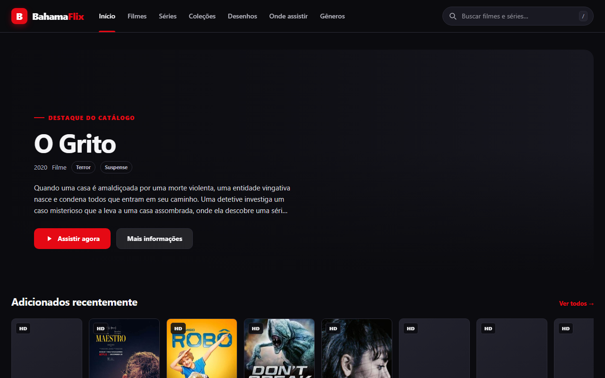
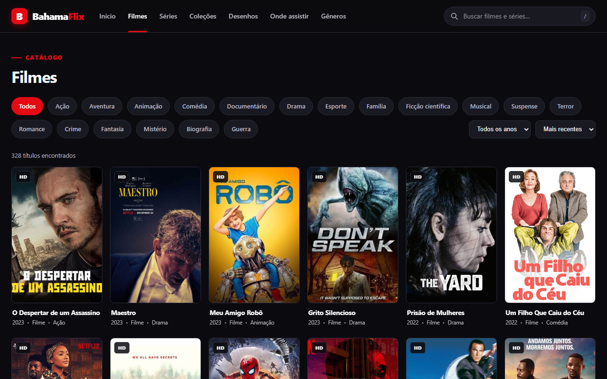
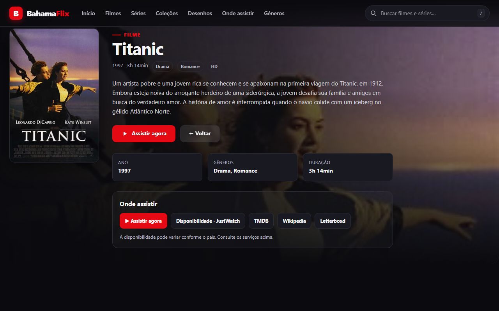
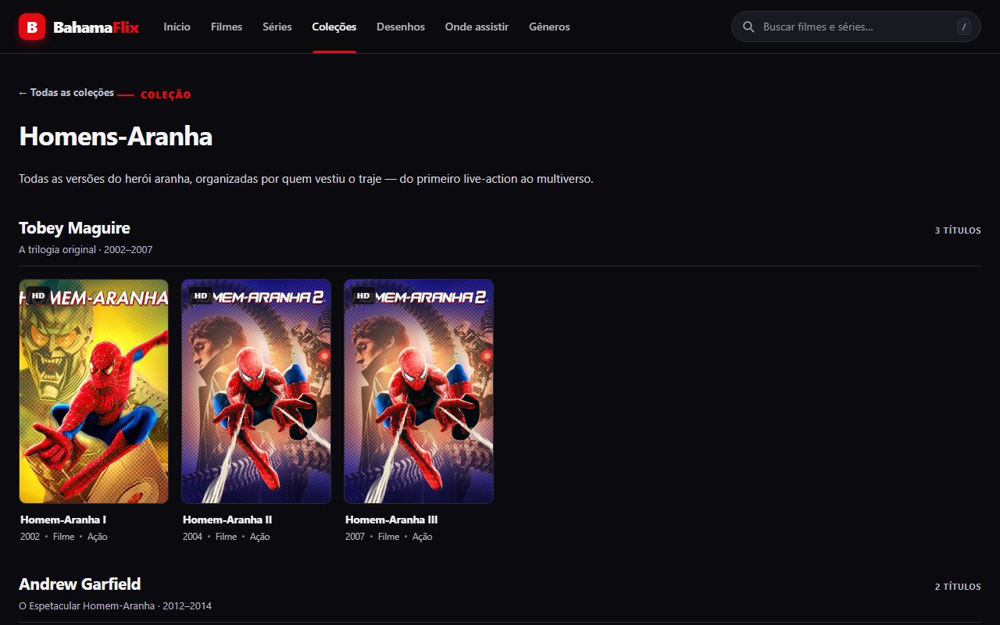
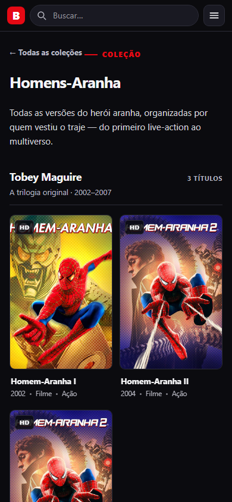

# Bahama Flix

Catálogo estático de filmes, séries e desenhos com busca instantânea, coleções por ator e franquia, séries organizadas por temporada com guia de episódios e um acervo de domínio público.

**Stack:** HTML · CSS · JavaScript (sem frameworks) · GitHub Pages

**Site publicado:** https://claviobahama.github.io/Bahamaflix/

## Capturas de tela

<p align="center">
  
  
</p>

<p align="center">
  
  
</p>

<p align="center">
  
  
</p>

---

## 1. Executando localmente

É necessário um servidor local porque os dados são carregados via `fetch`.

```powershell
npx serve .
# ou
npx http-server .
# ou (Python, quando disponível)
python -m http.server 8000
```

Abra `http://localhost:3000` (ou a porta indicada). Abrir o `index.html` diretamente com `file://` não funciona — o navegador bloqueia o carregamento dos JSON em `data/`.

## 2. Estrutura do projeto

```text
Bahamaflix/
├── index.html                 # aplicação (SPA com roteamento por hash)
├── manifest.webmanifest       # manifesto PWA (nome, ícones, atalhos)
├── sw.js                      # service worker (cache e funcionamento offline)
├── 404.html                   # página de erro personalizada
├── assets/
│   ├── css/style.css          # design system (sem Bootstrap/FontAwesome)
│   ├── icons/                 # ícones 192/512, maskable e apple-touch
│   └── js/
│       ├── catalog.js         # carrega e consulta todos os datasets em memória
│       ├── search.js          # busca com sugestões e atalhos de teclado
│       ├── app.js             # roteador, séries, episódios e renderização
│       └── pwa.js             # registro do service worker e botão “Instalar app”
├── data/
│   ├── catalog.json           # 344 títulos do catálogo original
│   ├── public-domain.json     # 45 obras de domínio público (Internet Archive)
│   ├── enrichment.json        # metadados TMDB/TVmaze e links de pesquisa
│   ├── series.json            # 24 séries agrupadas por temporada
│   ├── episodes.json          # guias de episódios (TVmaze, apenas metadados)
│   ├── available-episodes.json # nomes de arquivos das pastas públicas (sem links diretos)
│   ├── platforms.json         # 14 serviços e fontes verificadas
│   ├── collections.json       # coleções por ator/franquia (Homens-Aranha, Star Wars, Kamui)
│   └── pages.json             # conteúdo das páginas institucionais
├── media/                     # 540 imagens organizadas por pasta original
├── scripts/
│   ├── migrate.js             # migração única do layout antigo
│   ├── build-catalog.js       # extrai os dados dos HTMLs legados
│   ├── fetch-public-domain.js # gera o acervo de domínio público
│   ├── enrich-metadata.js     # gera enrichment.json (TMDB opcional + TVmaze)
│   ├── build-series.js        # agrupa temporadas em páginas de série
│   ├── fetch-episodes.js      # gera episodes.json a partir da TVmaze
│   ├── fetch-available-episodes.js # lê as pastas públicas → available-episodes.json
│   ├── generate-sitemap.js    # gera sitemap.xml e robots.txt
│   └── check-links.js         # valida imagens, links, dados e arquivos
├── archive/                   # HTMLs e ferramentas originais (preservados)
├── sitemap.xml
├── robots.txt
└── netlify.toml
```

## 3. Rotas

A navegação usa hash (`#/`), o que elimina a necessidade de rewrites no servidor e faz com que páginas inexistentes retornem 404 de verdade.

| Rota | Descrição |
|---|---|
| `#/` | Início com destaques e seções do catálogo |
| `#/filmes` | Catálogo de filmes com filtros |
| `#/series` | Índice de séries (uma página por série, com temporadas) |
| `#/serie/<slug>` | Página da série com temporadas e guia de episódios |
| `#/colecoes` | Índice de coleções |
| `#/colecao/<slug>` | Coleção agrupada por ator ou franquia |
| `#/titulo/<slug>` | Detalhe do filme, desenho ou temporada, com “Onde assistir” |
| `#/desenhos` | Desenhos e animações |
| `#/plataformas` | Diretório de serviços com busca integrada |
| `#/generos` · `#/genero/Ação` | Índice e páginas de gênero |
| `#/busca?q=termo` | Resultados de busca |
| `#/sobre` · `#/faq` · `#/contato` · `#/privacidade` · `#/termos` · `#/cookies` | Páginas institucionais |

### Séries como no site antigo

`node scripts/build-series.js` agrupa títulos como `Naruto T1` … `Naruto T7` em uma única série “Naruto”. A página da série lista as temporadas e os **episódios disponíveis**: `scripts/fetch-available-episodes.js` lê a listagem pública das pastas e salva apenas os nomes dos arquivos de vídeo (por exemplo, os 25 episódios de “Naruto T1”). Nenhum link direto de vídeo é capturado ou hospedado — o botão **Abrir episódios** aponta para a pasta original.

Abaixo da lista disponível há um guia complementar com números, **títulos em português** e datas de estreia. `node scripts/translate-episodes.js` aproveita os títulos portugueses já presentes no acervo (181 em Naruto) e traduz os demais metadados da TVmaze. Quando a pasta e o guia divergem (como em Naruto, cuja pasta “1 ao 25” tem 25 arquivos e a primeira temporada da TVmaze tem 13), a lista da pasta é apresentada primeiro como fonte da disponibilidade real.

### Coleções por ator

`data/collections.json` agrupa versões de um mesmo herói por intérprete — como no site antigo, mas integrado ao roteador da aplicação. Em **Homens-Aranha** a ordem é Tobey Maguire, Andrew Garfield, Nicholas Hammond e Tom Holland. **Star Wars** e **Kamui, o Ninja Solitário** também têm aba própria. Cada grupo exibe somente títulos existentes no catálogo, e `scripts/check-links.js` valida as referências.

## 4. Regenerando dados e validando

```powershell
node scripts/build-catalog.js       # lê archive/ → data/catalog.json
node scripts/fetch-public-domain.js # Internet Archive → data/public-domain.json
node scripts/enrich-metadata.js     # TMDB/TVmaze → data/enrichment.json
node scripts/build-series.js        # agrupa temporadas → data/series.json
node scripts/fetch-episodes.js      # TVmaze → data/episodes.json
node scripts/fetch-available-episodes.js # pastas públicas → data/available-episodes.json
node scripts/translate-episodes.js  # títulos em português → data/episodes.json
node scripts/generate-sitemap.js    # gera sitemap.xml + robots.txt
node scripts/check-links.js         # valida o resultado
```

### Enriquecimento completo com TMDB

Sem chave, o script gera apenas links diretos de pesquisa (TMDB, JustWatch, Wikipedia) e dados de séries da TVmaze. Para incluir pôsteres, notas, trailers e “onde assistir” por região (BR), obtenha uma chave gratuita em <https://www.themoviedb.org/settings/api> e execute:

```powershell
$env:TMDB_API_KEY="sua_chave"; node scripts/enrich-metadata.js
```

Para publicar em outro domínio:

```powershell
$env:SITE_URL="https://meu-dominio.com"; node scripts/generate-sitemap.js
```

## 5. O que foi corrigido nesta reorganização

- **Busca funcional**: implementada em memória (título, sinopse, gênero, ano e fonte), com sugestões, filtros, ordenação e atalho `/`. O antigo `search.js` chamava uma API `/api/search` inexistente.
- **Erro de JavaScript**: o `script.js` antigo referenciava `#search-btn`, inexistente em 36 páginas, e lançava `TypeError`.
- **Séries organizadas**: temporadas agrupadas em páginas de série, com guia de episódios e acesso direto à pasta de cada temporada.
- **Coleções restauradas**: Homens-Aranha organizado por Tobey Maguire, Andrew Garfield, Nicholas Hammond e Tom Holland, além das abas de Star Wars e Kamui.
- **Estatísticas de visitas**: contador invisível (imagem de 1 pixel, sem cookies e sem JavaScript) com relatório privado para o mantenedor. O link de acesso não é público e fica apenas com o dono do projeto.
- **Links e imagens quebrados**: 59 referências locais com problemas foram eliminadas. Os dados são extraídos e validados antes de entrar no catálogo.
- **Anúncios intrusivos removidos**: popunder, social bar e scripts de redes de anúncios foram descartados da nova interface (o arquivo `ads.txt` foi mantido na raiz).
- **Tudo em português**: interface, textos institucionais e os 1.967 títulos de episódios do guia.
- **Procedência visível**: cada título mostra sua fonte no cartão e na página de detalhe, sem selos paralelos.
- **Fontes verificadas**: cinco projetos com licença declarada (CineArquivo, Netflex, NEOWATCH, Moving Image Archive e Bear Creek Cinema) foram adicionados a “Onde assistir”, com link para o repositório e a licença do código.
- **PWA**: manifesto, service worker, ícones adaptativos, atalhos e botão “Instalar app”. O catálogo, as páginas e os dados abrem offline após o primeiro carregamento.
- **SEO**: `netlify.toml` não transforma mais qualquer URL em `index.html` com status 200; `sitemap.xml`, `robots.txt` e `404.html` foram gerados.
- **Estrutura**: HTMLs legados e ferramentas antigas ficam em `archive/`, imagens em `media/`, e o código ativo em `assets/`, `data/` e `scripts/`.

## 6. PWA (Progressive Web App)

O site pode ser instalado como aplicativo em celulares, tablets e computadores:

- `manifest.webmanifest` define nome, cores, ícones, modo `standalone` e atalhos para Busca, Séries e Onde assistir.
- `sw.js` guarda o casco da aplicação (HTML, CSS, JS, ícones) e todos os JSON de `data/` no primeiro acesso. Depois disso, navegação e busca funcionam offline; imagens já visitadas também ficam em cache.
- `assets/js/pwa.js` registra o service worker e mostra o botão **Instalar app** no rodapé quando o navegador oferece a instalação. No iPhone, o botão vira **Adicionar à tela inicial** e abre um passo a passo, pois o Safari não dispara o prompt automático.
- Ícones em `assets/icons/`: `192`, `512`, versão `maskable` e `apple-touch-icon`.
- `netlify.toml` serve `/sw.js` sem cache longo e `/manifest.webmanifest` com `Content-Type` correto.

Para testar localmente, use `http://localhost:3000` (service workers exigem origem segura; `localhost` é considerado seguro). A instalação aparece no menu do navegador ou pelo botão do rodapé.

### Instalando no iPhone (Safari)

O Safari da Apple não dispara o evento `beforeinstallprompt`, então o prompt automático do Chrome/Edge não existe no iOS. No iPhone, toque em **Adicionar à tela inicial** no rodapé e siga o modal:

1. Toque no botão **Compartilhar** do Safari (quadrado com seta para cima).
2. Role a lista e escolha **Adicionar à Tela de Início**.
3. Confirme o nome **BahamaFlix** e toque em **Adicionar**.

O ícone aparece na tela inicial e o site abre em modo `standalone`, sem a barra do navegador. O botão do rodapé some quando o app já está instalado. Use Safari — outros navegadores do iOS não conseguem criar o atalho de tela inicial com o mesmo resultado.

Ao alterar os JSON de `data/` ou os arquivos de `assets/`, incremente a versão da constante `CACHE` em `sw.js` para que os visitantes recebam a nova versão.

## 7. Observações

- Os links de acesso apontam para serviços externos e não são controlados por este projeto.
- Todo o conteúdo original foi preservado em `archive/`; nada foi descartado.
- Projeto pessoal/acadêmico. Respeite a licença dos títulos, imagens e marcas antes de qualquer uso comercial.
